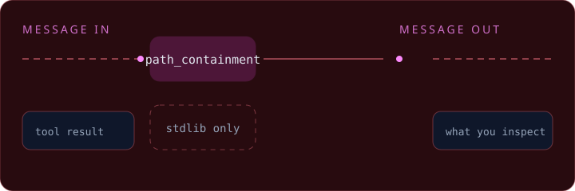

<p align="center">
  
</p>

<p align="center">
  <a href="https://pypi.org/project/path-containment/"></a>
  <a href="https://pypi.org/project/path-containment/"></a>
  <a href="https://pypi.org/project/path-containment/"></a>
  <a href="https://github.com/sandeshbagmare/path-containment/actions/workflows/ci.yml"></a>
  <a href="https://github.com/sandeshbagmare/path-containment/blob/main/LICENSE"></a>
  <a href="https://sandeshbagmare.github.io/path-containment/"></a>
  <a href="https://pypi.org/project/path-containment/"></a>
</p>

<h3 align="center">keep untrusted paths inside their directory</h3>
<p align="center"><em>Standard library only. No runtime dependencies. Python 3.9+.</em></p>

<p align="center">
  
</p>

## Install

```console
pip install path-containment
```

## API

```python
from path_containment import (
    UnsafePathError, is_within, safe_join, safe_member_name, safe_target, sanitize_filename,
)

is_within("/srv/uploads", "/srv/uploads/a/b.txt")    # True
is_within("/srv/uploads", "/srv/other")              # False

safe_join("/srv/uploads", "reports", "q1.pdf")       # /srv/uploads/reports/q1.pdf
safe_join("/srv/uploads", "../etc/passwd")           # raises UnsafePathError

safe_member_name("./docs\\a.txt")                    # "docs/a.txt"
safe_member_name("/etc/passwd")                      # raises
safe_target("/srv/uploads", "..\\..\\win.ini")       # raises

sanitize_filename('a/b:c?.txt')                      # "a_b_c_.txt"
sanitize_filename("CON")                             # "_CON"
sanitize_filename("name.txt...")                     # "name.txt"
```

Every refusal raises `UnsafePathError`, a `ValueError`, with a message that says what
was wrong with which component.

## Why not `os.path.join`

`os.path.join("uploads", "../../etc/passwd")` returns a path outside `uploads`, and
`Path.resolve()` alone only tells you where it *lands* — after the fact. On Windows
`ntpath.isabs("/etc/passwd")` is `False` (there is no drive), so a check that relies on
`isabs` alone lets that through. Both cases are covered here, and the resolved result is
compared against the resolved base, which also catches a symlink that points outside.

## Behaviour worth knowing

- ``safe_join`` returns an **absolute, resolved** path. It creates nothing.
- A missing target is fine: only the path is checked, not existence.
- ``safe_member_name`` normalises `\` to `/`, strips `./`, collapses `//`, and refuses
  absolute paths, drive letters, control characters and any `..` component.
- ``sanitize_filename`` keeps unicode, replaces `/ \ : * ? " < > |` and control
  characters, trims trailing dots and spaces, prefixes reserved Windows device names
  (`CON`, `NUL`, `COM1`…) and truncates to `max_length` without leaving a trailing dot.

## Development

```console
python -m venv .venv
.venv/bin/pip install -e ".[test]"
.venv/bin/pytest
```

## License

MIT.
